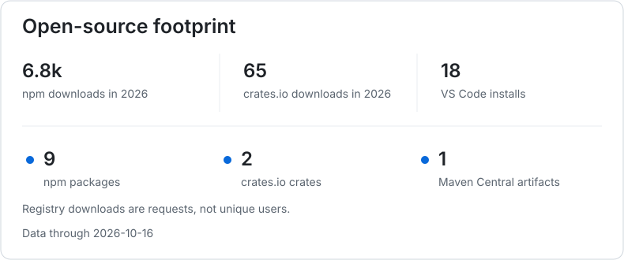
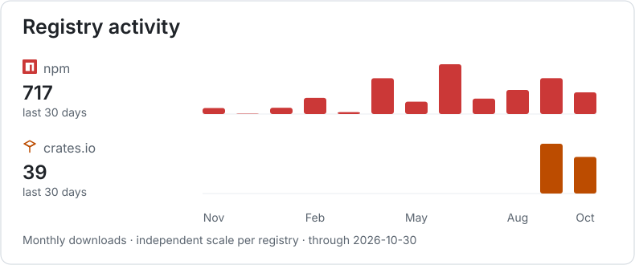

# Hello, I'm JF 👋

Backend engineer and occasional software architect, building pragmatic systems.

I build things I use, or wish existed, and keep the repositories open in case they are useful to someone else.

I work with coding agents as part of my day-to-day development workflow, mainly through OpenCode, and I build tools around that workflow too.

  

- 🏜️ Based in **Almería, Spain**
- 🚀 Co-founder at [Hexacode](https://hexacode.es)
- 💻 Usually somewhere between backend systems, software architecture and developer tooling
- 🎮 Outside code: Age of Empires II and FIBA basketball

## Core stack

       

Also working with Python, MongoDB, gRPC, GitHub Actions, Prometheus, Grafana, Terraform, Kubernetes and Cloudflare. Still trying to find excuses to build things in Go.

*Small tools, disproportionate joy: jq, regex and automating the repetitive bits.*

## Featured projects

- **[Adaptive Admission Controller](https://github.com/jfrz38/adaptive-admission-controller)** — The Rust core for priority-aware load shedding and adaptive concurrency, controlled by a deterministic PID state machine. 
  `Rust` · `WebAssembly` · [crates.io](https://crates.io/crates/adaptive-admission-core) · [docs.rs](https://docs.rs/adaptive-admission-core)  
- **[NestJS OpenAPI Wrapper](https://github.com/jfrz38/nestjs-openapi-generator-wrapper)** — Opinionated NestJS structures and templates on top of OpenAPI Generator. 
  `TypeScript` · `NestJS` · `OpenAPI` · [npm](https://www.npmjs.com/package/@jfrz38/nestjs-open-api-generator-wrapper)  
- **[Clean Architecture Highlighter](https://github.com/jfrz38/clean-architecture-highlighter)** — Architecture dependency rules in the editor, linter and command line. 
  `TypeScript` · `VS Code` · `ESLint` · [Marketplace](https://marketplace.visualstudio.com/items?itemName=jfrz38.clean-architecture-highlighter)  
- **[cocommit](https://github.com/jfrz38/cocommit)** — A keyboard-driven terminal UI for building Conventional Commits. 
  `Rust` · `ratatui` · `Git` · [crates.io](https://crates.io/crates/cocommit)  
- **[OpenCode Copy Last](https://github.com/jfrz38/opencode-copy-last)** — Copies the latest response or exchange without leaving the terminal. 
  `TypeScript` · `OpenCode` · [npm](https://www.npmjs.com/package/@jfrz38/opencode-copy-last)

## More projects

<strong>🧱 Backend libraries & adapters</strong>

- **[PID Rate Limiter](https://github.com/jfrz38/rate-limit-pid-controller)** — Node.js adapter for Adaptive Admission Controller, with Express and NestJS integrations. [npm packages](https://www.npmjs.com/search?q=%40jfrz38%2Fpid-controller)
- **[NestJS Cache Proxy](https://github.com/jfrz38/nestjs-cache-proxy)** — Transparent, declarative caching for NestJS providers. [npm](https://www.npmjs.com/package/@jfrz38/nestjs-cache-proxy)
- **[mockguard](https://github.com/jfrz38/mockguard)** — Strict Mockito validation that detects interactions left unverified. [Maven Central](https://central.sonatype.com/artifact/io.github.jfrz38/mockguard)

<strong>☁️ Systems & cloud</strong>

- **[EdgeFlags](https://github.com/jfrz38/edgeflags)** — An experimental edge-native feature flag service with authentication, scoped authorization and automated delivery.

<strong>🛠️ Developer tooling & automation</strong>

- **[check-version-change](https://github.com/jfrz38/check-version-change)** — Detects version changes across npm, PyPI, Maven, crates.io, Go modules and Git refs. [Marketplace](https://github.com/marketplace/actions/check-version-change)
- **[verify-release-tag](https://github.com/jfrz38/verify-release-tag)** — Validates that a release tag matches a manifest version and expected commit. [Marketplace](https://github.com/marketplace/actions/verify-release-tag)
- **[auto-version-bump-action](https://github.com/jfrz38/auto-version-bump-action)** — Reusable SemVer bumps for Gradle, npm and custom project files. [Marketplace](https://github.com/marketplace/actions/auto-version-bump-action)

<strong>🤖 OpenCode workflow</strong>

- **[OpenCode Wololo Notifications](https://github.com/jfrz38/opencode-wololo-notifications)** — Configurable Age of Empires II sounds for agent events. [npm](https://www.npmjs.com/package/@jfrz38/opencode-wololo-notifications)

<strong>🧪 Experiments & side quests</strong>

- **[smart-world-map](https://github.com/jfrz38/smart-world-map)** — A physical LED map following the ISS, nearby flights and earthquakes.
- **[worldhunt](https://github.com/jfrz38/worldhunt)** — An offline hot-and-cold country guessing game for the terminal. [crates.io](https://crates.io/crates/worldhunt)
- **[wololang](https://github.com/jfrz38/wololang)** — An esoteric language built from Age of Empires II taunts. Yes, `wololo` is valid syntax.
- **[bash-http-lab](https://github.com/jfrz38/bash-http-lab)** — An HTTP/1.1 server built in plain Bash to explore what web frameworks hide.
- **[rocket-api-test](https://github.com/jfrz38/rocket-api-test)** — A small Rust API exploring layered design, dependency inversion and value objects.

[Browse all repositories →](https://github.com/jfrz38?tab=repositories)

## Packages in the wild

Registry requests are not unique users, but they are a useful pulse of where these tools travel.

  <picture>
    <source media="(prefers-color-scheme: dark)" srcset="./profile/distribution-dark.svg">
    <source media="(prefers-color-scheme: light)" srcset="./profile/distribution-light.svg">
    
  </picture>

  <picture>
    <source media="(prefers-color-scheme: dark)" srcset="./profile/registry-activity-dark.svg">
    <source media="(prefers-color-scheme: light)" srcset="./profile/registry-activity-light.svg">
    
  </picture>

## GitHub snapshot

*Public repositories only.*

  <picture>
    <source media="(prefers-color-scheme: dark)" srcset="./profile/stats-dark.svg">
    <source media="(prefers-color-scheme: light)" srcset="./profile/stats-light.svg">
    
  </picture>
  <picture>
    <source media="(prefers-color-scheme: dark)" srcset="./profile/top-langs-dark.svg">
    <source media="(prefers-color-scheme: light)" srcset="./profile/top-langs-light.svg">
    
  </picture>

---

🔥 **Coding like I play AoE II:** *stressful and crying*

